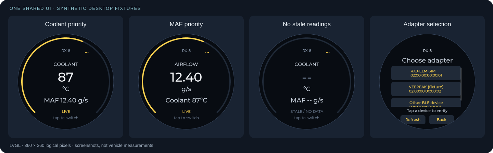

# RX-8 Gauge

**A removable, battery-powered coolant and MAF display for the Mazda RX-8.**

[](LICENSE)


<p align="center">
  
</p>

<p align="center"><em>Concept render: current cradle geometry, approximate device
housing, and a simulated screen. Not a photograph or a tested mounting installation.</em></p>

The idea is simple: a large temperature reading you can glance at, a useful
secondary airflow reading, and an honest indication when the data is missing.
No phone, no infotainment replacement and no permanent vehicle wiring.

## What it does

- **Direct BLE OBD-II connection** to an ELM-compatible adapter, targeting the
  Veepeak OBDCheck BLE+.
- **Coolant in °C and MAF in g/s**, with a touch-switchable main reading.
- **Clear connection and data states:** connecting, live, unavailable, stale
  and unsupported are not interchangeable.
- **Adapter discovery, selection, remembered reconnect and Forget.**
- **One shared LVGL UI** on the ESP32-S3 and the Linux desktop simulator.
- **Repeatable development without a car:** TCP/BLE protocol simulators,
  deterministic fault tests, synthetic fixtures and headless screenshots.
- **Read-only laptop capture tools**, including an owned start/stop sleep/lid
  inhibitor for unattended recording.
- **Editable FreeCAD cradle, verified STL and editable Blender scene.**

## The display



*Actual shared-UI desktop screenshots using synthetic fixtures; not live vehicle data.*

## Status and limits

Coolant/MAF acquisition has been exercised with a real RX-8/Veepeak pair, and
the gauge has been used in the car. Bench and host tests cover protocol faults,
disconnect/reconnect and missing/unsupported data. This is **not a compatibility
guarantee for every adapter, vehicle or firmware version**.

This remains a **passive prototype**, not a certified warning instrument:

- No validated over-temperature thresholds or oil-temperature readiness signal.
- Battery capacity/runtime, low-power behaviour and parked-adapter drain still
  need measurement.
- The cradle passes digital mesh/dimensional checks; physical fit, adhesive
  bonding, heat and ordinary driving retention are **not validated**.
- No DTC clearing, VIN queries, arbitrary ECU commands or vehicle control.

Do setup/testing while parked, idle the engine only outdoors, and secure all
equipment away from controls and airbag deployment areas. Do not leave the
battery-powered device in conditions beyond its documented limits.

## Try it without hardware

Linux dependencies: Git, `uv`, CMake, Ninja, a C/C++ compiler, SDL2 development
files and libpng development files. On Ubuntu/Debian:

```sh
sudo apt-get install build-essential cmake ninja-build git pkg-config libsdl2-dev libpng-dev
```

From a checkout:

```sh
bash tools/bootstrap.sh --no-idf --dev --capture
bash tools/test-desktop.sh
desktop/build/gauge_desktop --scenario normal
```

The bootstrap pins Python and optional development/capture packages. The build
helper downloads and checks the pinned LVGL source. The desktop needs no board,
Bluetooth connection or car; its transport is loopback-only.

For protocol-driven simulation, run in separate terminals:

```sh
python3 simulator/elm_sim.py --scenario normal --fragment-bytes 3
desktop/build/gauge_desktop --elm-port 35000
```

[Desktop guide](desktop/README.md) · [Simulator guide](simulator/README.md)

## Build the device firmware

Target: **Waveshare ESP32-S3-Touch-LCD-1.85B**, 360 × 360 LCD with touch.
Other similarly named Waveshare boards are not interchangeable.

```sh
bash tools/bootstrap.sh --dev --capture
bash tools/idf.sh -C firmware build
# Only when deliberately flashing your attached board:
bash tools/flash.sh /dev/serial/by-id/YOUR_DEVICE
```

Firmware dependencies are pinned to **ESP-IDF 5.5.3**, **LVGL 9.5.0** and the
tracked component lockfile. Board support is vendored with its original
licenses. The bootstrap does not flash hardware or configure system permissions.

[Development/setup](docs/development.md) · [Hardware](docs/hardware.md)

## Mechanical design

The current v4 concept is a **domed, top-loading cradle**: lower semicircular
capture lip, back support, open top, no separate latch or detents.

| File | Purpose |
| --- | --- |
| [FreeCAD model](mechanical/models/cradle-v4.FCStd) | Native, editable feature tree and dimension controls |
| [STL](mechanical/models/cradle-v4.stl) | Digitally verified manufacturing mesh, in millimetres |
| [Validation report](mechanical/models/cradle-v4.validation.json) | Hash-bound mesh and CAD comparisons |
| [Blender scene](mechanical/renders/cradle-v4-studio.blend) | Packed, editable presentation scene |

Overall mesh bounds are about **76.44 × 52.55 × 76.58 mm**; nominal cradle
opening is **62.2 mm**. These are not physical fit measurements.
Original modelling scripts and regeneration/verification workflows are included.

[Mechanical guide](mechanical/README.md) · [Design notes](docs/mechanical-design.md)

## Capture and testing

For a real-car capture, turn off other OBD clients and follow the parked setup
checks in the [raw capture guide](docs/real-car-capture.md). Captures preserve
raw bytes and timing—not decoded CSV—and remain local by default.

[BLE development](docs/ble-development.md) explains physical-radio versus host
test boundaries. [Contributing](CONTRIBUTING.md) lists checks and reporting
guidance; [roadmap](docs/roadmap.md) tracks remaining product work.
The [validation snapshot](docs/validation.md) records clean-build checks and
their boundaries.

## Repository layout

```text
firmware/      ESP-IDF application and BLE transport
protocol/      portable ELM session/decoders
ui/            shared LVGL display and settings
desktop/       native Linux UI + loopback transport
simulator/     Python ELM TCP/BLE frontends
tests/         protocol, UI, capture and recovery tests
mechanical/    CAD sources, native model, verified STL and render scene
tools/         reproducible setup, builds and capture utilities
docs/          hardware, workflows and operating limits
third_party/   deliberately vendored board support and original licenses
```

**No private workspace is required.** Downloaded tools, caches and local captures
default to ignored `.local/aux/` inside the checkout. `GAUGE_AUX` can select a
different absolute path. Nothing from a previous project's auxiliary directory
is needed to build this one.

## License

Original code, documentation, CAD and artwork: **[The Unlicense](LICENSE)**.
Vendored components retain their own licenses; see
[third-party notices](THIRD_PARTY.md). No manufacturer affiliation or endorsement
is implied.
