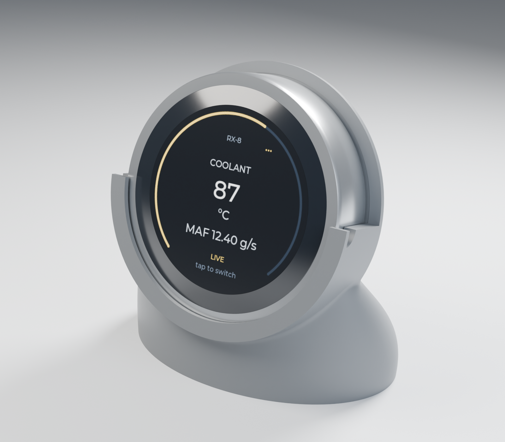

# Mechanical: v4 top-loading cradle



The current design is a domed, hollow-backed base with a lower semicircular
retaining lip, back support and open top. It has **no clips or upward latch**.
It is a digital concept, not a road-qualified mount.

## Published assets

- [Editable native FreeCAD model](models/cradle-v4.FCStd): authoritative geometry,
  native feature dependency tree and `Dimensions` spreadsheet; no plugin required.
- [Manufacturing STL](models/cradle-v4.stl), in **millimetres**, and its
  [byte-bound validation report](models/cradle-v4.validation.json).
- [Packed editable Blender scene](renders/cradle-v4-studio.blend),
  [studio PNG](renders/cradle-v4-studio.png) and
  [render provenance](renders/cradle-v4-studio.metadata.json).
- [Shared demo UI texture](render-assets/gauge-normal.png), packed in the scene.

Original project assets use **The Unlicense**, as at the repository root.
This does not relicense third-party libraries, tools, fonts or other vendor
material; their own notices remain applicable.

## View and edit CAD

Open `models/cradle-v4.FCStd` in FreeCAD, or run
`freecad mechanical/view_simple_cradle.FCMacro` from the repository root.
The macro only changes presentation in memory: it does not save, generate,
export or create scratch directories. An already-open document is reused, so
unsaved hand edits are not replaced. Save edits under a new name before export.

The current solid is `TopLoadingCradle`; `ReferenceGeometry` is not manufactured.
Use the `Dimensions` spreadsheet for parametric edits. Changing controls can
invalidate booleans/fillets; always recompute, inspect and revalidate.

## Rebuild source concept

Commands below run from the repository root. Install FreeCAD separately;
its Python modules must match the system Python ABI. On a typical Linux install:

```sh
export PYTHONPATH=/usr/lib/freecad/lib
/usr/bin/python mechanical/build_top_loading.py --no-detents
/usr/bin/python -m unittest discover -s mechanical -p 'test*.py'
```

Defaults write new directories under `${GAUGE_AUX:-<repo>/.local/aux}/mechanical`.
Set `GAUGE_AUX` to relocate scratch work, or pass `--out NEW_DIRECTORY`.
Existing output directories are rejected, never overwritten.

`build_top_loading.py --no-detents` generates the current v4 concept.
Its helper modules `build_cradle.py`, `build_enclosed_cradle.py` and
`build_fit_test.py` retain the native primitive/expression/baseline construction
needed by v4 and regression tests. Their intermediate models and the optional
detent branch are development fixtures, **not alternative approved print files**.
Regeneration creates a new editable model; it never replaces the published
native file or incorporates subsequent hand edits automatically. Different
FreeCAD/OpenCascade versions can produce different tessellation/feature results.

## Export and audit

Use the native model you actually edited, not a regenerated baseline:

```sh
/usr/bin/python mechanical/export_verified_stl.py \
  --cad mechanical/models/cradle-v4.FCStd \
  --out .local/aux/mechanical/export/cradle.stl \
  --report .local/aux/mechanical/export/cradle.validation.json

/usr/bin/python mechanical/validate_stl.py mechanical/models/cradle-v4.stl \
  --cad mechanical/models/cradle-v4.FCStd \
  --report .local/aux/mechanical/audit.json
```

Explicit paths take precedence over scratch defaults. Export and audit reports
refuse existing destinations; use a new name for each revision.
See [validation scope](STL-validation.md), [render workflow](RENDERING.md) and
[design/physical limitations](../docs/mechanical-design.md).
